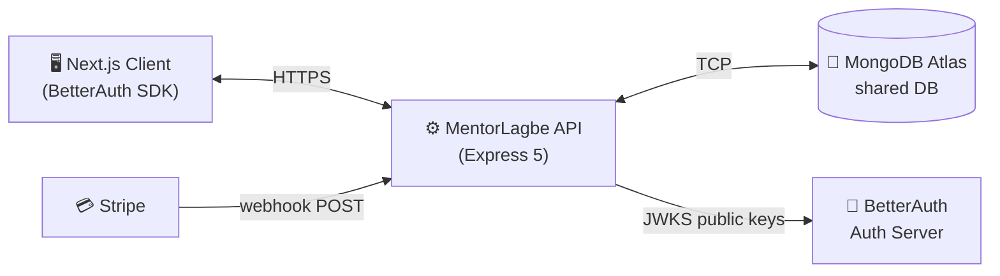

<div align="center">

# 🎓 MentorLagbe Server

**The backend engine behind MentorLagbe, a tutor discovery & tuition marketplace connecting verified mentors with students across Bangladesh.**

[](https://nodejs.org/)
[](https://expressjs.com/)
[](https://www.mongodb.com/atlas)
[](https://mentor-lagbe-s.vercel.app/)

🌐 **Live API:** [mentor-lagbe-s.vercel.app](https://mentor-lagbe-s.vercel.app/)

</div>

---

## 🧭 Quick Navigation

| 🚀 Start | 🏗️ Build | 📡 Reference | 🛡️ Ship |
|---|---|---|---|
| [Overview](#-overview) | [Architecture](#%EF%B8%8F-architecture) | [API Reference](#-api-reference) | [Deployment](#%EF%B8%8F-deployment) |
| [Features](#-features) | [Project Structure](#-project-structure) | [Auth & RBAC](#-authentication--authorization) | [Testing](#-testing) |
| [Getting Started](#-getting-started) | [Tech Stack](#-tech-stack) | [Security](#%EF%B8%8F-security) | [Contributing](#-contributing) |

---

## 🔍 Overview

MentorLagbe Server runs the backend of a role-aware tuition marketplace:

- 🎒 **Students** discover verified tutors and apply to tuition posts.
- 👨‍🏫 **Tutors** publish listings and manage incoming applications.
- 🧑‍⚖️ **Admins** approve tutors and moderate content quality.

The API is built on three principles:

1. **🔐 Security-first:** JWTs are verified via JWKS, roles are read from the database on every request, and mass-assignment is blocked at the route boundary.
2. **📐 Predictable:** one response envelope, one error handler, centralized input validation.
3. **☁️ Stateless & serverless-ready:** no in-memory session state, so it runs on Vercel and scales horizontally.

> The companion Next.js client lives in a separate repository and shares the same MongoDB instance for BetterAuth compatibility.

---

## ✨ Features

<table>
<tr>
<td width="50%" valign="top">

### 🧩 Core
- 🔐 **BetterAuth-compatible JWT auth**: asymmetric JWKS verification, no shared secrets
- 👥 **RBAC**: `student`, `tutor`, `admin` enforced server-side on every protected route
- 📚 **Tuition listings**: full CRUD with ownership checks on every mutation
- 🎓 **Tutor profiles**: public reads, authenticated writes, admin-only approval
- 📝 **Applications**: students apply; tutors accept or reject their own
- 💳 **Stripe webhooks**: raw-body handling for subscription and plan events
- 🖼️ **Image uploads**: portrait and banner, with file-type and size validation

</td>
<td width="50%" valign="top">

### ⚙️ Platform
- 🧾 **Consistent envelope**: every response is `{ success, data, message }`
- 🛡️ **Centralized errors**: Mongoose, multer, duplicate keys, and JSON parse failures mapped to clean HTTP codes
- ✅ **Input validation**: pagination clamped to 1–50, regex escaping, mode normalization
- 🧪 **Tests**: unit tests via `node --test` plus an end-to-end API sweep
- 📘 **Documented contract**: see [`API.md`](./API.md)
- 🔍 **Honest security posture**: see [`SECURITY.md`](./SECURITY.md)

</td>
</tr>
</table>

---

## 🧰 Tech Stack

| Layer | Technology |
|---|---|
| ⚡ Runtime | Node.js ≥ 20 (ESM) |
| 🚂 Framework | Express 5 |
| 🍃 Database | MongoDB Atlas (Mongoose 8) |
| 🔑 Auth | BetterAuth (JWKS / JWT via `jose`) |
| 🖼️ File Storage | External image host (URLs stored in DB) |
| 💳 Payments | Stripe webhooks |
| ☁️ Deployment | Vercel (serverless functions) |
| 🧪 Testing | `node --test` + custom API sweep |

---

## 🏗️ Architecture



### 🔄 Request Lifecycle

1. 📨 Client sends `Authorization: Bearer <JWT>`.
2. 🔎 `auth.middleware.js` verifies the token against the JWKS endpoint, checks `iss`, `aud`, `exp`, and confirms `sub` is a valid MongoDB ObjectId.
3. 🗄️ The middleware loads the user from MongoDB and attaches `req.dbUser`. **The role is never trusted from the token.**
4. 🚦 `requireRole(...)` guards enforce the correct role per route.
5. 🙋 Ownership checks in each mutation handler confirm the caller owns the resource.
6. 📦 The response passes through the shared success/error envelope.

---

## 🚀 Getting Started

### 📋 Prerequisites

- ✅ **Node.js** ≥ 20.x
- ✅ **npm** ≥ 10.x
- ✅ A **MongoDB Atlas** cluster (or local MongoDB 6+)
- ✅ A **BetterAuth** deployment with a JWKS URL
- ➕ *(Optional)* A **Stripe** account for webhook testing

### 📥 Installation

```bash
# 1. Clone the repository
git clone https://github.com/aminulislamdev/Mentor-Lagbe-Server.git
cd Mentor-Lagbe-Server

# 2. Install dependencies
npm install

# 3. Set up environment variables
cp .env.example .env   # then fill in your values

# 4. Start the dev server
npm run dev
```

The API will be available at **http://localhost:8000** (configurable via `PORT`).

### 🔧 Environment Variables

<details>
<summary><b>👀 Click to view all variables</b></summary>

| Variable | Required | Description |
|---|:---:|---|
| `PORT` | ❌ | HTTP port (default `8000`) |
| `NODE_ENV` | ✅ | `development` \| `production` |
| `MONGODB_URI` | ✅ | MongoDB connection string |
| `CLIENT_URL` | ✅ | Frontend origin allowed by CORS |
| `JWKS_URL` | ✅ | BetterAuth JWKS endpoint |
| `AUTH_ISSUER` | ✅ | Expected JWT `iss` claim |
| `AUTH_AUDIENCE` | ✅ | Expected JWT `aud` claim |
| `STRIPE_SECRET_KEY` | ❌ | Stripe secret key (if using payments) |
| `STRIPE_WEBHOOK_SECRET` | ❌ | Stripe webhook signing secret |

</details>

> ⚠️ **`JWT_SECRET` is not used.** The server relies on asymmetric JWKS verification. If it's in your `.env`, it's a leftover and can be removed.

### ▶️ Running Locally

```bash
npm run dev      # 🔁 Development, auto-reload via nodemon
npm start        # 🏁 Production mode
npm test         # 🧪 Unit tests
npm run verify   # 🧹 Full API end-to-end sweep
```

---

## 📜 Available Scripts

| Script | What it does |
|---|---|
| `npm run dev` | Start with nodemon for auto-reload |
| `npm start` | Start in production mode |
| `npm test` | Run unit tests with `node --test` |
| `npm run verify` | Run the end-to-end API sweep |
| `npm run lint` | Lint the codebase *(if configured)* |

---

## 📡 API Reference

> 📖 The full, canonical reference lives in [**API.md**](./API.md). Here's the quick map:

### 🌍 Public

| Method | Endpoint | Description |
|:---:|---|---|
| `GET` | `/api/health` | ❤️ Liveness check |
| `GET` | `/api/tuitions` | 📚 List public tuition listings (paginated) |
| `GET` | `/api/tuitions/:id` | 🔎 Get a single tuition |
| `GET` | `/api/tutors` | 🎓 Browse tutor profiles |

### 🔒 Authenticated

| Method | Endpoint | Role | Description |
|:---:|---|:---:|---|
| `GET` | `/api/users/me` | any | 👤 Get current user |
| `PATCH` | `/api/users/me` | any | ✏️ Update profile (whitelisted fields) |
| `POST` | `/api/tuitions` | tutor | ➕ Create a tuition listing |
| `PATCH` | `/api/tuitions/:id` | owner | ✏️ Update own listing |
| `DELETE` | `/api/tuitions/:id` | owner | 🗑️ Delete own listing |
| `POST` | `/api/applications` | student | 📝 Apply to a tuition |
| `PATCH` | `/api/applications/:id` | owner | ✅ Accept / ❌ reject an application |

### 👑 Admin

| Method | Endpoint | Description |
|:---:|---|---|
| `PATCH` | `/api/tutors/:id/approve` | ✅ Approve or reject a tutor |
| `PATCH` | `/api/tuitions/:id/moderate` | 🚩 Hide or flag a listing |

### 🪝 Webhooks

| Method | Endpoint | Description |
|:---:|---|---|
| `POST` | `/api/stripe/webhook` | 💳 Stripe event receiver *(raw body)* |

### 📦 Response Shapes

**✅ Success**
```json
{
  "success": true,
  "data": { "...": "..." },
  "message": "Operation completed"
}
```

**❌ Error**
```json
{
  "success": false,
  "message": "Validation failed",
  "errors": { "field": "reason" }
}
```

---

## 📂 Project Structure

```text
Mentor-Lagbe-Server/
├── 🗄️ config/
│   └── db.js                      # Mongoose connection
├── 🎮 controllers/
│   ├── tuition.controller.js
│   ├── user.controller.js
│   ├── application.controller.js
│   └── webhook.controller.js
├── 🧱 middleware/
│   ├── auth.middleware.js         # JWKS verification + role loading
│   ├── error.middleware.js        # Centralized error handler
│   └── validate.js                # Input validation helpers
├── 📐 models/
│   ├── User.js
│   ├── Tuition.js
│   └── Application.js
├── 🛣️ routes/
│   ├── tuition.routes.js
│   ├── user.routes.js
│   ├── application.routes.js
│   └── webhook.routes.js
├── 🧰 utils/
│   ├── jwt.js                     # JWKS client (jose)
│   └── response.js                # Success/error helpers
├── 🧪 tests/
│   └── *.test.js
├── 🚪 index.js                    # App entry point
├── 📘 API.md                      # Canonical API contract
├── 🛡️ SECURITY.md                 # Security posture & checklist
└── 📦 package.json
```

---

## 🔐 Authentication & Authorization

MentorLagbe uses **BetterAuth** to issue JWTs. The server verifies them against a JWKS endpoint, so **no shared secret is ever stored on the server.**

### 🛂 Rules enforced by `auth.middleware.js`

- ✅ JWT signature verified via JWKS
- ✅ `iss`, `aud`, and `exp` claims checked
- ✅ `sub` must be a 24-character MongoDB ObjectId
- ✅ User loaded from MongoDB on every request, so role changes apply immediately
- ✅ Only `req.dbUser.role` is trusted for authorization

### 🎭 Role Matrix

| Role | Can do |
|---|---|
| 🎒 `student` | Browse listings, apply to tuitions, edit own profile |
| 👨‍🏫 `tutor` | Publish / edit / delete own listings, manage applications, edit own profile |
| 👑 `admin` | Full moderation, approve tutors, hide listings |

---

## 🛡️ Security

Security is a first-class artifact, documented in [**SECURITY.md**](./SECURITY.md).

**✅ In place**
- JWKS-based (asymmetric) JWT verification
- Role enforcement via DB lookup
- Ownership checks on every mutation
- Whitelisted PATCH bodies (no mass-assignment)
- Centralized error handler that hides internal details
- CORS restricted to `CLIENT_URL`
- `x-powered-by` disabled

**🚧 Planned / in progress**
- Rate limiting via `express-rate-limit`
- Security headers via `helmet`
- Least-privilege MongoDB user
- Real DB-backed health check

> 🐞 **Found a vulnerability?** Please email the maintainers directly instead of opening a public issue.

---

## ☁️ Deployment

The production API runs on Vercel: **[mentor-lagbe-s.vercel.app](https://mentor-lagbe-s.vercel.app/)**

1. 🍴 Fork or clone the repo.
2. 🔗 Connect it to Vercel as a new project.
3. 🔑 Set all required environment variables in the Vercel dashboard.
4. 🚀 Deploy. Vercel auto-detects the Express entry point.

### ⚡ Serverless Notes

- 🔌 **Cache the MongoDB connection** across invocations to avoid Atlas connection exhaustion. Confirm `config/db.js` caches the connection promise at module scope.
- 🪝 **Mount the Stripe webhook route before `express.json()`** so the raw body survives for signature verification.
- 🥶 Cold starts add ~300–500 ms, so keep dependencies minimal.

---

## 🧪 Testing

```bash
npm test           # 🧪 Unit tests
npm run verify     # 🌐 End-to-end API sweep (starts the server, exercises every route)
```

Tests live in `tests/`. The end-to-end sweep should run against a **seeded local database**, never production.

---

## 🤝 Contributing

Contributions are welcome! 🎉

1. 💡 **Open an issue** describing the bug or feature.
2. 🌿 **Fork** and branch: `git checkout -b feat/your-feature`
3. 🎨 Follow the existing style: ES modules, centralized validation, response envelope.
4. 🧪 **Add tests** for new behavior.
5. ✅ Make sure `npm test` and `npm run verify` pass.
6. 📬 **Open a PR** with a clear description and a linked issue.

**Commit convention:** `feat:` · `fix:` · `chore:` · `docs:` · `refactor:` · `test:`

---

## 📄 License

Licensed under the **MIT License**. See the [LICENSE](./LICENSE) file for details.

---

## 📬 Contact

| | |
|---|---|
| 👤 **Author** | Aminul Islam |
| 💻 **Repository** | [github.com/aminulislamdev/Mentor-Lagbe-Server](https://github.com/aminulislamdev/Mentor-Lagbe-Server) |
| 🌐 **Live API** | [mentor-lagbe-s.vercel.app](https://mentor-lagbe-s.vercel.app/) |
| 🐛 **Issues** | [Open an issue](https://github.com/aminulislamdev/Mentor-Lagbe-Server/issues) |

---

<div align="center">

<sub>💙 Built with care for the MentorLagbe community.</sub>

</div>